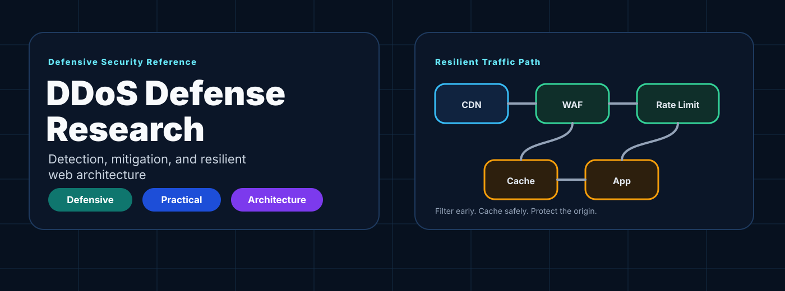
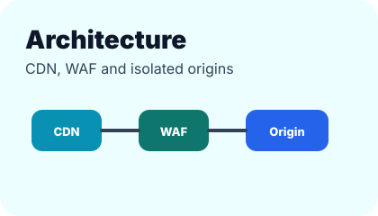
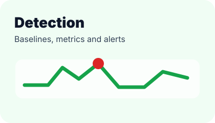
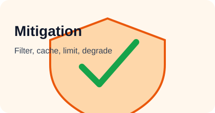
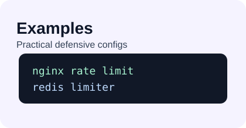
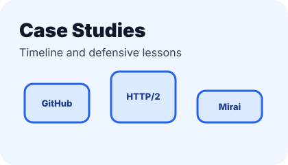
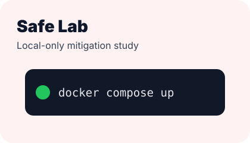

# DDoS Defense Research

  

> A practical, defensive research repository about Distributed Denial of Service
> attacks: how they work at a high level, how to detect them, and how to design
> systems that keep serving real users under pressure.

Persian version: [README.fa.md](README.fa.md)

## Visual Overview

  
  
  

  
  
  

  
  
  
  
  
  
  
  
  
  

## Runnable defense reference

[فارسی](README.fa.md) · v1.0 candidate; no release published.
The existing PR branch is the executable candidate; main has not been merged.

| Component | Executed/tested | Boundary or conceptual part |
|---|---|---|
| Matched Express comparison | Same fixed window, memory 1/2 processes and Redis 2 processes; 3 real trials | Small functional experiment, not capacity benchmark |
| Proxy identity | Direct spoofing, trusted/untrusted peers, IPv4-mapped IPv6 and /64 | No external CDN topology tested |
| Redis | Lua concurrency, TTL repair, real outage/recovery; open/closed policies | Single ephemeral Redis, no HA/durability claim |
| NestJS / Nginx | Separate HTTP, budget and configuration tests | Different algorithms; excluded from matched comparison |
| Cloudflare / route cost | Reviewed template / unregistered metadata | Not deployed / no weighted-budget enforcement |

## Quick start

Requires Git, Node 24.22.0 + npm, Docker Linux containers and Compose >=2.24.
No keys or paid services are required. Published ports bind only to 127.0.0.1.

~~~sh
git clone --branch prepare-educational-v1 https://github.com/Amir-Ali-Dev/ddos-defense-research.git
cd ddos-defense-research
npm ci
npm run build
docker compose -f lab/docker-compose.yml -f lab/compose.test.yml --profile all up -d --build --wait --wait-timeout 120
curl -i http://127.0.0.1:3001/api/status
npm test
npm run test:redis
npm run experiment:run
docker compose -f lab/docker-compose.yml -f lab/compose.test.yml --profile all down -v --remove-orphans
~~~

Expected status: 200 with JSON ok=true, then 429 when a budget is exhausted; Redis
fail-closed returns 503 while unavailable. The login route does not authenticate users.
Experiments stop/restart the disposable Redis and use fixed loopback ports 3410–3417.

## Recorded evidence

In [three recorded trials](docs/EXPERIMENT-RESULTS.md), 16 requests with logical budget
6 produced 6 accepted with memory-one, 12 with memory-two and 6 with shared Redis.
The NAT scenario limited 2 of 4 regular users sharing one IP. Raw JSON/CSV, exact
versions, trial dispersion and real-data figures are archived with the results.
The sample is too small for statistical/performance ranking. Application request
limits cannot protect a saturated bandwidth link.

- [Experiment protocol, chart commands and cleanup](experiments/README.md).
- [Lab profiles, prerequisites and troubleshooting](docs/RUNNING.md).
- [Design decisions](docs/DECISIONS.md) · [Proxy/failure runbook](docs/OPERATIONS.md).
- [English theory](docs/reference.en.md) · [Persian theory](docs/reference.fa.md).
- [Validation](docs/VALIDATION.md) · [CI definition](.github/workflows/ci.yml).
- [Nginx](examples/nginx/README.md) · [NestJS](examples/nestjs/README.md) · [Redis](examples/redis/README.md) · [Cloudflare](examples/cloudflare/README.md).
- [Case studies](case-studies/README.md) · [Sources](references/README.md) · [Dependencies](docs/DEPENDENCIES.md).
- [Security](SECURITY.md) · [Contributing](CONTRIBUTING.md) · [License status](docs/LICENSE-STATUS.md).
- [Changelog](CHANGELOG.md) · [Draft release notes](docs/RELEASE-v1.0.md) · [Metadata suggestions](.github/REPOSITORY_SETUP.md).
