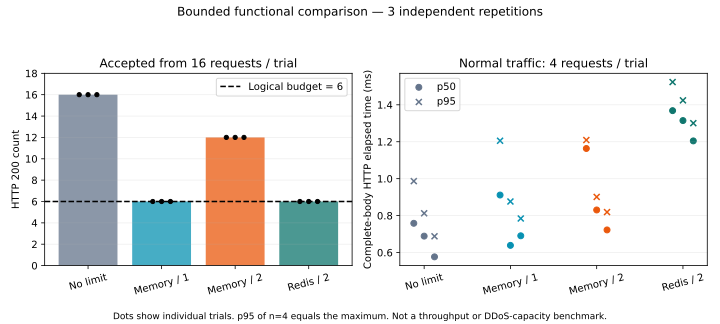

# Recorded comparison results

Executed in [GitHub Actions run 39169760646, attempt 1](https://github.com/Amir-Ali-Dev/ddos-defense-research/actions/runs/39169760646).
PR head: `a6a22c71991c57ae0f02d9bab13c243558550bd4`; runner checkout/merge SHA:
`40cc0babe4b578bb9e7600b7d428345830687500`. These measurements belong to that source,
not to unexecuted revisions. The run and resource cleanup succeeded.

The controller completed 3 warmed independent repetitions in 21.83 s: 684 measured
requests, 48 warm-up requests, and 810 total HTTP requests including readiness probes.
Measured concurrency was 1, budget 6, first-request-anchored window 1200 ms.
All four modes used the same Express code. NestJS/Nginx results were not pooled.

Environment: Linux x64, kernel 6.17.0-1022-azure, Intel Xeon 6973P-C, 4 logical CPUs,
16,765,378,560 bytes reported RAM; Node 24.22.0, Express 5.3.0, node-redis 6.3.0,
Redis server 8.2.10, Docker Engine 28.0.4. Complete versions and image IDs are in raw data.
Comparison app processes ran on the Linux runner, Redis in its Docker container;
this is not a comparison of containerized application performance.

## Data and reproducibility

- [Raw JSON with config/environment/events](../experiments/results/ci-39169760646/raw.json).
- [Every request as CSV, including labelled warm-up](../experiments/results/ci-39169760646/requests.csv).
- [Per-trial status counts, percentiles and spread](../experiments/results/ci-39169760646/summary.json).
- [Protocol and reproduction commands](../experiments/README.md).

## Counts and multiple instances

Each table entry is per repetition; results were identical across all 3 repetitions
(accepted min=median=max, not a confidence interval).

| Mode | Normal, 4 requests | Excess, 16 requests | Accepted / logical budget of 6 | NAT, 8 requests | Regular NAT users limited / 4 |
|---|---|---|---|---|---|
| No limiter | 4 × 200 | 16 × 200 | Not applicable | 8 × 200 | 0 |
| Memory, 1 process | 4 × 200 | 6 × 200, 10 × 429 | 1.0 | 6 × 200, 2 × 429 | 2 |
| Memory, 2 processes | 4 × 200 | 12 × 200, 4 × 429 | 2.0 | 8 × 200 | 0 |
| Redis, 2 processes | 4 × 200 | 6 × 200, 10 × 429 | 1.0 | 6 × 200, 2 × 429 | 2 |

The memory-two case did not gain a larger shared budget: it unintentionally had two
independent budgets under round-robin routing. Redis enforced one shared counter.
This is evidence for the tested topology and schedule, not a proof of every load-balancer behavior.

A regular NAT user here means a labelled user making 2 requests/window, below 6 on
their own. Four such users shared one real loopback source IP. Labels did not enter
the identity key. The 2 rejected requests affected 2 users in each single-budget mode.
Memory-two avoiding these rejections is not evidence of better fairness: it also failed
the intended aggregate cap. All are unauthenticated IP budgets.

## Boundary and outage observations

In every trial, 2 anchor + 10 pre-expiry requests yielded 6 accepted in memory-one and
Redis, versus 12 in memory-two. After expiry, another 12 attempts yielded 6 and 12
respectively. Excluding the two early anchors, the adjacent before/after batches
accepted 10 requests in the single-budget modes across the boundary. See completion
timestamps in raw data; no sliding-window guarantee is implied.

During each real Redis stop, the closed group returned 503, the open group returned
200 with `X-RateLimit-Policy: fail-open`, and memory/no-limit groups continued returning
200. Readiness was 503 in both Redis groups. After restart, both Redis groups returned
200 without the failure-policy header. Each uses a separate shared namespace.

Readiness recovery, measured from immediately before the Docker start command:

| Repetition | Closed process A | Closed process B | Open process A | Open process B |
|---|---:|---:|---:|---:|
| 1 | 473.73 ms | 474.75 ms | 475.79 ms | 476.85 ms |
| 2 | 503.02 ms | 503.87 ms | 504.80 ms | 505.68 ms |
| 3 | 485.18 ms | 486.00 ms | 486.80 ms | 487.85 ms |

These times include Docker CLI overhead, reconnect delay and polling (100 ms), with
sequential probe order. They are observed readiness times, not intrinsic Redis recovery
latencies or an availability SLA. Redis persistence was disabled; restart erased budgets.

## Latency and variation

Normal-traffic complete-body HTTP elapsed times, 4 requests per trial. Each cell is
**minimum / median / maximum of the 3 trial percentiles**, in milliseconds:

| Mode | p50 across trials | p95 across trials |
|---|---|---|
| No limiter | 0.577 / 0.689 / 0.758 | 0.688 / 0.813 / 0.987 |
| Memory, 1 process | 0.639 / 0.691 / 0.911 | 0.784 / 0.876 / 1.205 |
| Memory, 2 processes | 0.722 / 0.830 / 1.163 | 0.819 / 0.901 / 1.209 |
| Redis, 2 processes | 1.204 / 1.315 / 1.368 | 1.300 / 1.424 / 1.523 |

Percentiles use sorted nearest rank `ceil(p*n)-1` with no interpolation. p95 at n=4 is
the maximum; these are descriptive observations, too small for statistical inference.
Fixed mode order, a shared runner, process scheduling and HTTP connection overhead
can confound timing. No latency threshold gates CI. These data do not rank frameworks,
measure DDoS/throughput capacity or establish production readiness.
